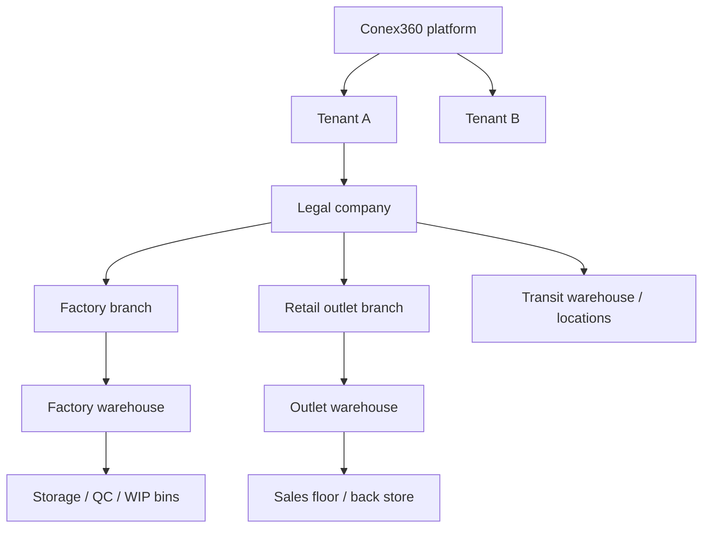

# Product overview
- Product: **Conex360**; parent company: **SysConex** (https://www.sysconex.com/). Proposed tagline: Your Entire Business. Connected.
- Business model: one hosted application with logically isolated subscribing businesses (multi-tenant SaaS). Each customer configures its own business name, logo, locations, users, document branding and enabled modules. The customer does not receive a separate fork of source code.
- Initial customer: coconut product business (oil, milk, desiccated coconut, food/cosmetics and other products); actual product recipes, number of outlets and procedures must be confirmed. Support raw materials, non-coconut ingredients, packaging, bulk, finished goods, byproducts, expiry, batch, weighing, offline billing.
- Future customers: retail, wholesale and manufacturing; other verticals can be extensions, not hard-coded coconut logic. Keep manufacturing optional for retail-only tenants.

## Scope hierarchy

Each tenant can have multiple companies. Each company has branches (factory, retail STORE, warehouse, office), warehouses and stock locations. An outlet is a branch, not a separate tenant; a branch can have several warehouses. Each register belongs to an authorized branch and selling warehouse. Central managers may see company-wide stock subject to permission. Branch operators see only granted outlets. Separate companies do not share stock by ordinary transfer even when they have one tenant; intercompany sales/purchases are a later feature.

## Vocabulary
| Term | Meaning |
|---|---|
| SKU/item | Distinct stock item/pack size; stock held in base UOM |
| Lot/batch | Physical production or purchase identity; system lot for untracked items |
| Bucket | Lot + location + owner + condition |
| On hand | Physical quantity in a bucket; not automatically sellable |
| Available | Eligible on-hand minus outstanding reservations, excluding transit, hold, expired, recalled or non-sellable locations |
| In transit | Dispatched but not yet received or resolved; not sellable |
| Posted | Immutable business event with durable effects |
| FEFO / FIFO | Earliest eligible expiry for physical picking / first-in cost valuation |
| Business date | Local operational/accounting date, distinct from UTC occurrence |

Success means accurate, reconciled stock and finances, traceability, safe branch transfers, simple checkout, data isolation, and recoverable operations. No claim that every advanced module is included in the first contract.
