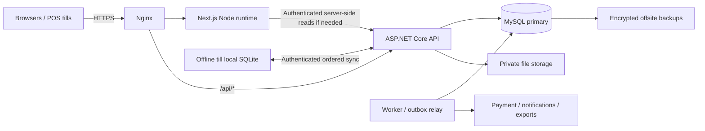

# Technical architecture
## Baseline choices
| Layer | Direction |
|---|---|
| Backend | ASP.NET Core .NET 10 LTS, C#; modular monolith |
| DB | MySQL 8.4 LTS, InnoDB, utf8mb4, strict SQL, UTC |
| Data access | MySqlConnector, parameterized SQL for critical posting; EF Core only after compatibility and concurrency validation |
| Frontend | Next.js + TypeScript (confirmed); App Router and Node runtime proposed; React components, shared API contracts |
| Offline | Packaged till/local service + encrypted SQLite, durable outbox; implementation design pending |
| Hosting | Linux VPS (Ubuntu LTS proposed), Nginx, Docker Compose proposed |
| SCM/CI | Private GitHub organization/repository, GitHub Actions proposed |
| Files | Private backed-up volume or object store; scoped metadata |

Pin supported SDK, runtime, Node/package manager, DB image, dependencies and deployment artifacts at M0. Verify real compatibility before selecting patch versions; no speculative version numbers. Provisional pilot size: 4 vCPU/8 GB, storage sized by workload and retention; not a guarantee.


One business posting transaction uses one connection to primary MySQL. No microservices, message broker or distributed stock transactions initially. Outbox consumers process committed events at least once and deduplicate. Reports may later move to read replicas; authoritative decisions stay on primary. Single VPS is a single failure domain.

## Proposed repository structure (not yet generated)
```text
AGENTS.md
README.md
docs/
database/reference/     # historical SQL only
database/migrations/    # reviewed versioned migrations, created at M0
backend/Conex360.sln
backend/src/Conex360.Domain/
backend/src/Conex360.Application/
backend/src/Conex360.Infrastructure/
backend/src/Conex360.Api/
backend/src/Conex360.Worker/
backend/tests/Conex360.UnitTests/
backend/tests/Conex360.IntegrationTests/
frontend/               # Next.js + TS, src/app, src/features, shared UI/API
infrastructure/         # Docker, proxy, environment examples, runbooks
.github/workflows/
```
Domain depends on no infrastructure. Application depends on Domain and interfaces; Infrastructure implements adapters; API/Worker compose dependencies. Prefer module folders and explicit interfaces to hundreds of generic repositories. No generic unscoped CRUD. Separate command paths and query projections without requiring full CQRS frameworks.

| Module | Owns | Calls/dependencies |
|---|---|---|
| Platform/Identity | tenants, grants, features, subscriptions | identity provider, audit |
| Catalog | items, UOM, barcode, pricing/tax | scoped company config |
| Procurement | PO, receipts, supplier matches/returns | Inventory, Finance |
| Inventory | buckets, balances, transfers, reservations, counts, costing | document services, Finance for value effects |
| Manufacturing | recipe version, plans, production events, WIP allocation | Inventory, Quality, Finance |
| Quality | inspection, lot disposition, genealogy/recalls | Inventory, Manufacturing |
| Sales/POS | orders, deliveries, invoices, sessions/returns | Inventory, Finance, Payments |
| Finance/Payments | journals, open items, settlement, tender confirmation | provider adapters |
| Offline/Integration | device quotas and operation inbox, outbox, feed | same online commands under authorized device context |
| Reporting | scoped projections, exports | read only, committed data |
| Later workforce/assets/planning | own domain records | Finance and Inventory public contracts |

Only Inventory writes stock ledger/balance. Only Finance writes financial journals. An application coordinator calls both in the same transaction; avoid cyclic dependencies by passing explicit effect requests/results through the coordinator. Business rules belong in services/aggregates, not controllers, Next.js Server Actions or React components.

## Next.js integration boundary
Nginx routes application pages and Next.js assets to the frontend, and the reserved `/api/` namespace to ASP.NET Core. Server-side frontend reads may use an internal API base URL but must forward authenticated context safely; never use a privileged service credential to bypass user permissions. Browser requests use the same-origin API. A thin BFF is optional only after an authentication ADR; no duplicate business services, independent persistence or financial commands in Next.js. Tenant-specific rendering is dynamic/non-cacheable; public assets alone may be cached globally. Select runtime/cache controls against the pinned framework version. Offline checkout remains a separately approved local device service; Next.js alone does not provide durable offline inventory or payment synchronization.
