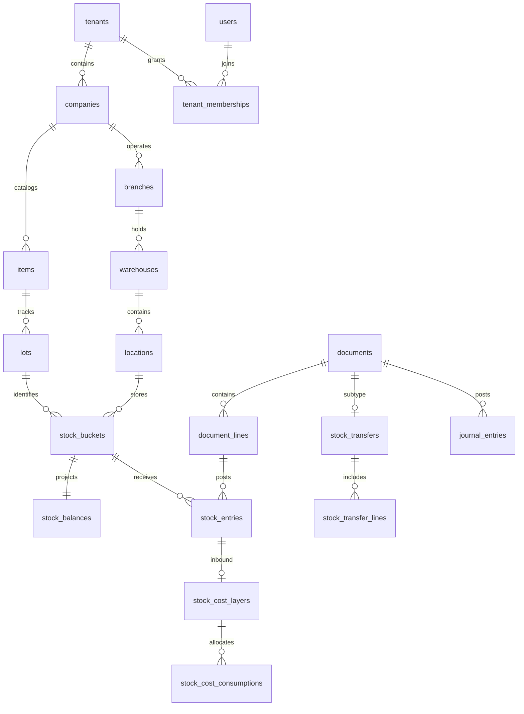

# Database design and implementation rules
The historical schema is [01_schema.sql](../database/reference/01_schema.sql), 160 tables and 636 foreign keys from the 23 November design. It is an unmodified reference, not a tested migration. See [database readiness](../database/README.md) and [table index](reference/SCHEMA_INDEX.md). Preserve names and relationships unless an approved ADR and migration change them.

## Model overview

Conceptual relationship view; actual DDL constraints govern.

| Area | Existing table families |
|---|---|
| Tenancy | tenants, users, tenant_memberships, roles, permissions, membership_roles, companies, branches, membership_branches, company_role_grants, warehouses, locations, tenant_features, subscriptions |
| Master data | currencies, units, items, item_units, item_barcodes, item_categories, parties, party_roles, price_lists, tax_codes, tax_rates |
| Document core | document_sequences, documents, document_lines, document_links, document_taxes, document_approvals, attachments |
| Stock | lots, inventory_owners, stock_buckets, stock_balances, stock_entries, stock_reservations, stock_cost_layers, stock_cost_consumptions, stock_value_adjustments, stock_transfers, stock_transfer_lines, stock_counts, stock_adjustments, reorder_policies |
| Production/QC | recipes, recipe_versions, recipe_inputs, recipe_outputs, production_orders, production_events, production_event_lines, production_costs, production_cost_allocations, lot_genealogy, quality_inspections, lot_status_events, recalls |
| Commercial | purchase_orders, goods_receipts, supplier_invoices, purchase_matches, sales_orders, deliveries, sales_invoices, customer_returns, sales_credits, pos_sessions, weighing_events |
| Finance | accounts, accounting_periods, journal_entries, journal_lines, open_items, settlements, payments, payment_tenders, payment_intents, bank_accounts, expenses |
| Reliability | idempotency_keys, outbox_messages, integration_inbox, audit_events, devices, offline_operations, offline_stock_allocations, sync_cursors, change_feed |

## Standards
- Global identity only in users and explicitly shared references. Every tenant-owned row includes tenant_id; company-owned records include company_id. Composite keys and joins ensure relationships stay scoped. Authorize every read; FK constraints cannot prevent leaking SELECTs.
- Use BIGINT UNSIGNED internal PKs per reference. Public document/user UUIDs are BINARY(16); use a documented consistent UUID byte order. JSON IDs are strings. C# unsigned ID mapping tested. Never treat guessed IDs as authorization.
- DECIMAL(24,9) base quantities/conversions, DECIMAL(24,6) values where defined; validate limits, precision and rounding. Local currency rounding belongs to approved policy. C# decimal can represent individual schema decimals but intermediate multiplication may overflow; bound and test.
- DATETIME(6) UTC for events, DATE for business dates and expiry. Company timezone configuration; Sri Lanka pilot Asia/Colombo proposed. Document numbers assigned under scoped sequence lock and never reused after posting.
- Document roots/typed headers share IDs; typed lines use line registry. Status DRAFT/SUBMITTED/APPROVED/POSTED/REVERSED/VOID. Lock roots before posting; guards enforce immutability for posted facts and controlled lifecycle changes. Business corrections are new linked documents.
- Physical lot genealogy independent of cost FIFO. Ledger is authoritative; balances are rebuildable projections updated transactionally. No stock quantity field on items as source of truth.
- Migrations are checksum tracked and applied by a dedicated deployment job, never each API instance. Expand/contract; test empty install and prior-release upgrade on real MySQL. Never disable FKs to hide errors.

## Known transfer schema review
Existing stock_transfers.stage supports REQUEST, DISPATCH, RECEIPT; stock_transfer_lines links receipt to dispatch_line_id; locations.kind supports TRANSIT; stock_entries pairs movements with movement_group. This supports the foundational design but additional reviewed linkage/indexes may be required for multi-lot dispatch allocations, exact receipt-to-dispatch-lot reconciliation, shortage dispositions, split cost lineage, transfer groups and cumulative request quantities. Use actual schema review and tests, not assumed columns. See detailed proposal in docs/04_INVENTORY_AND_TRANSFERS.md.

## Reconciliation targets
For each scoped bucket, SUM(stock_entries.quantity_base) = stock_balances.on_hand_base. Outstanding reservations <= eligible physical stock under policy; no negative balances. For every dispatch allocation, receipt and exception quantities <= dispatched, and remaining equals tagged transit. Cost layer totals and stock valuation reconcile to inventory control accounts. Journal debits = credits by currency basis; settlements cannot exceed open-item amounts. WIP inputs, costs, outputs and loss reconcile at close. Reconciliation differences must be reported and investigated, not overwritten.
