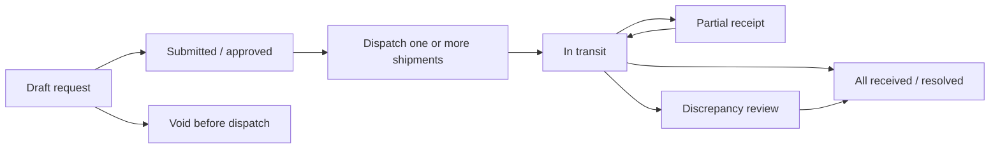

# Mandatory inventory and inter-outlet transfers
**Requirement IDs INV-01 through INV-04. Implement in M2; prerequisite for production and checkout.**

## Inventory hierarchy and visibility
A tenant may have multiple companies. Each company may have multiple outlets, factories and warehouses. A STORE branch represents a retail outlet; warehouse/bin placement records its stock. Do not use one global quantity per product. POS uses its assigned sellable warehouse(s), not company-wide stock. A company manager with grants can view quantities by item, outlet, warehouse, bin, lot, owner and condition; unauthorized outlets are excluded, not just hidden by the UI.

For each bucket, `on_hand = sum(signed posted entries)`; `outstanding_reservation = quantity_base - consumed_base` for ACTIVE reservations. `available_to_sell = on_hand - outstanding reservations` for eligible released, not expired/recalled, company-owned, sellable storage stock; other stock contributes zero availability. Report reserved, allocated offline, QC-held, damaged, blocked, expired and transit without double counting. Offline allocation is a reservation subtype, not an additional subtraction. Physical stock can be held without being sellable; distinguish physical totals from available quantities. No clamp masking integrity differences.

Support opening stock with costs, procurement receipt/return, issue/receipt in manufacturing, sales/delivery/return, condition changes, approved count variance, write-off and transfers. UOM conversions fixed per transaction; track lot and expiry even when moving between branches. System lot for items without batch tracking. FEFO chooses eligible earliest expiry; untracked/no expiry uses deterministic tie-break. Stock alerts at warehouse/outlet-specific thresholds; expiry alerts use business date and approved expiry semantics. Count snapshot at cutoff, control or reconcile subsequent movements and post approved variance only.

## Transfer lifecycle

The above are business/UI states derived from document states and quantities, not new values to insert into existing documents.status. Existing stage rows: REQUEST, DISPATCH, RECEIPT. A request can have multiple dispatches; each dispatch can have multiple receipts. A request may be cancelled for undisbursed remainder only after releasing its reservations. A dispatch is a posted event, not an editable status field. Support warehouse-to-warehouse and outlet-to-outlet moves within the same legal company. Source and destination cannot be the same warehouse for ordinary transfers; bin moves within a warehouse use a distinct internal movement command if implemented. Intercompany and cross-tenant transfers forbidden in this workflow.

| Step | Actor and permission (proposed names) | Ledger effect |
|---|---|---|
| Request | destination or central manager; transfer.request, scope verified | None; requested item/base quantities, source/dest, reason, required date |
| Approve | authorized manager; transfer.approve; configurable segregation | Optional reservation at source; no physical movement |
| Dispatch | source staff; transfer.dispatch; authorized source, approved destination | Negative source, equal positive dedicated transit; release/consume reservation correctly |
| Receive | destination staff; transfer.receive; destination grant | Negative transit, equal positive destination for actual lot/condition; partial supported |
| Resolve exception | supervisor; transfer.resolve, adjustment/finance permissions where required | Approved shortage write-off, return-to-source or damaged/held disposition; linked compensating/exception docs |
| View | transfer.read with source/destination participant scope | Read only; restrict details for non-granted locations |

Source/destination must be in same authenticated company. Source staff cannot receive on behalf of destination without grant. Destination staff can request source fulfillment with approved routing but cannot browse arbitrary source stock unless granted. Cross-outlet transfer workflow can expose the minimal counterpart identity/manifest needed to authorized participants, not unrelated inventory. Approval thresholds and self-approval rules configurable; default require separate approver for controlled discrepancies.

## Example with partial receipt
Opening Factory warehouse = 100 bottles; Outlet A = 20; transit = 0. Request 30, approve and reserve 30: factory available 70, physical 100. Dispatch 30: factory physical 70, transit 30, outlet physical 20. Receive 20: factory 70, transit 10, outlet 40. Receive 8: factory 70, transit 2, outlet 48. Investigate remaining 2: if later received, outlet 50; if confirmed lost, approved transit loss posts -2 and financial loss, outlet remains 48. Total physical inventory including transit stays 120 before approved loss, 118 after loss. No sale, no revenue, no COGS simply for moving stock. Damaged received goods are recorded in destination DAMAGED/QUARANTINE, not silently lost or made available.

## Physical and valuation posting rules
- Dispatch allocates actual lots, owners, conditions and source bins. Validate requested/approved remainder, reservations, available quantity and QC/expiry policy (restricted movement to quarantine allowed only via explicit permission). Choose FEFO; do not change lot identity or manufacture/expiry date. Transit bucket is in a dedicated non-sellable location (`locations.kind=TRANSIT`). Suggested company-level transit warehouse with route/dispatch allocation identity tracked separately; authorization grants must distinguish system-managed transit from ordinary warehouses.
- Each dispatch allocation has a source issue and transit receipt in one transaction. Match entries using movement_group and document line; persist exact origin and quantity. Each partial receipt consumes only its dispatch allocation, not arbitrary pooled transit for another shipment. Preserve lot/owner and document damaged condition at receipt. Lock dispatch allocation and original root before cumulative checks. Do not allow over-receipt, wrong lot, wrong destination, duplicate acknowledgement or unapproved substitutions.
- Value moves with the dispatch: consume source FIFO cost layers and establish linked transit layers, then consume the associated transit costs and create destination layers. No repricing at destination. If warehouse-specific inventory GL accounts are used, balanced reclassification is allowed; if one account, no net P&L entry. Do not recognize COGS or revenue. Freight capitalization, FIFO order preservation across moves, cost pool keys and rounding remainder policy require an ADR before enabling financial transfer posting. Use explicit source allocation lineage even when FEFO lot and FIFO cost layer differ.
- Reversal after posting is a new authorized correction. Never reverse a dispatch that has been received or partly consumed without first resolving its downstream effects; return flow references the original. Loss/disposal posts authorized accounting and quantity effects. No deletion of history, no auto-close with unexplained remainder.
- Use common posting transaction: scope, idempotency/hash, accounting period (where applicable), ordered root locks, balance/reservation locks, cost locks, validate, write entries/balances/finance/audit/outbox, mark POSTED, commit. If failure, rollback all; retry only recognized transient DB conflicts. Receipt and dispatch idempotency keys unique by actor/command with durable business reference.

## Proposed schema mapping and gaps to resolve before implementation
| Concept | Historical schema | Implementation decision / gap |
|---|---|---|
| Outlet | branches.kind=STORE; warehouses.branch_id | Do not add redundant outlet table. Configure default sale warehouse; validate register mapping. |
| Physical stock | stock_buckets, stock_entries, stock_balances, lots | Existing scoped keys; lock per bucket, eligible locations and reservations. |
| Transfer root | documents + stock_transfers, stage | Request → dispatch → receipt relationships via source_document_id/document_links; enforce source and target type/scope. |
| Lines | document_lines + stock_transfer_lines | receipt dispatch_line_id existing; dispatch-to-request line and cumulative requested limit need explicit reviewed linkage. |
| Allocation | stock_entries + movement_group, buckets | Existing movement evidence; add scoped transfer allocation records if needed to lock exact dispatch lot/bucket remaining and prevent pooled transit misuse. |
| Cost trace | stock_cost_layers, stock_cost_consumptions | Need explicit mapping to source/transit/destination cost allocations if current lineage is insufficient for partial receipts. |
| Exceptions | stock_adjustments, document_links, document_approvals | Need approved exception type/reason and dispatch allocation linkage; distinguish return, loss, damage, overage (overage investigation only). |
| Metadata | documents.notes, attachments, audit_events | Structured carrier/tracking/expected date optional; don't overload notes for key invariants. |

Candidate migration (not approved SQL): `transfer_dispatch_allocations` scoped keys + dispatch_line_id, request_line reference, source_entry_id, transit_entry_id, lot identity via bucket, quantity; `transfer_receipt_allocations` scoped link to dispatch allocation and receipt movement entries; `transfer_exception_allocations` link approved resolution. Immutable allocation events plus locked projection for remaining quantity. Derive lot/owner from referenced buckets, avoid redundant unchecked fields. Review against DDL; composite FKs, stable uniqueness, indexes, positivity and cumulative invariants; protect cross-row conditions in transaction. Do not generate active migration until ADR is accepted. Request/dispatch/receipt/cost and exception semantics are mandatory even if final schema uses different tables.

## User-facing screens and reports
Outlet stock overview with available/reserved/held/transit, warehouse/bin drilldown, batch/expiry and movement history. Transfer list with source/dest, requested/dispatched/received/remaining, status and dates; request form with item/UOM/quantity and availability (if permitted), approval queue, pick/dispatch manifest, receipt form showing outstanding lots and quantity, damage/shortage reasons, resolution queue, printable dispatch/receipt documents and audit. Consolidated report separates on-hand at outlets and transit; filters on business date, source, destination, item and status; no double counting. Alerts for aging transit and low/expiring stock.

## Minimum acceptance tests
- Source 100 / destination 20 / transit 0 example above, all steps including damage and loss.
- Two simultaneous dispatches for the last 10 units: only one succeeds; no negative balance. Two receipts of same remaining quantity: only one succeeds.
- Same command retry returns original result; changed payload under same key conflicts. Crash after ledger write before commit leaves no effects.
- Multiple lots of one SKU with identical unit but differing expiry; partial receipt cannot substitute lot or consume another dispatch transit.
- Attempt transfer to a foreign company/tenant, unauthorized destination receipt, same warehouse, negative/zero quantity, over-dispatch/over-receipt, closed accounting period, expired lot ordinary transfer, cancellation after dispatch: reject safely.
- Reservations (including offline quota) prevent over-allocation; transfer does not consume another sale's reservation. Rebuild balances and reconcile quantity and value after each scenario.
